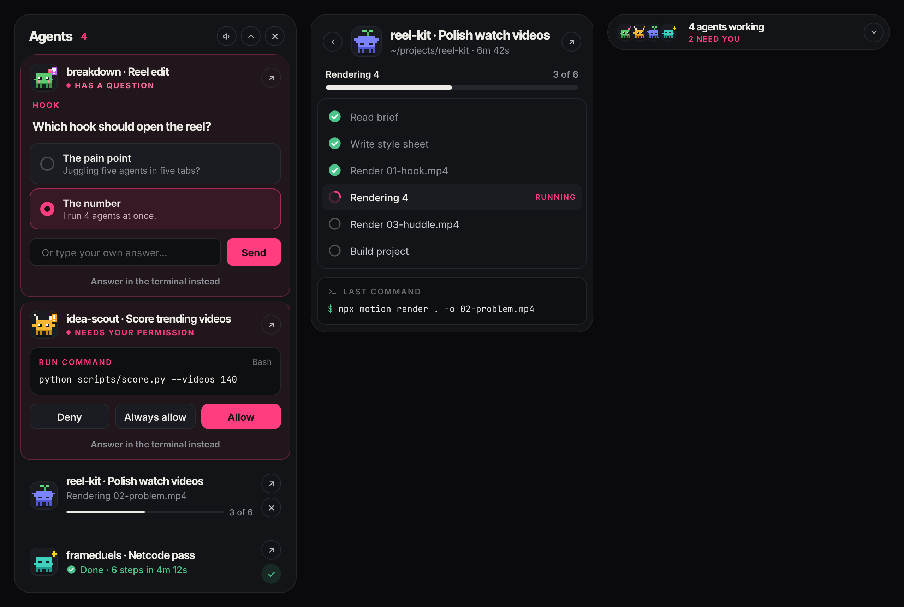

# Agent Hub · Glance

A small floating widget for Windows, in a dark "Nocturnal" glass style, that shows every Claude Code session you have running, and lets you approve permissions and answer questions without switching apps.



## Download

Get the latest installer from the [Releases page](https://github.com/DuzeraFer/AgentHub/releases/latest): download **Glance-Setup-x.y.z.exe** and run it. It installs for your user only (no admin rights), adds a Start Menu shortcut and starts Glance. Running a newer installer upgrades the existing install in place.

The installer is not code-signed, so Windows SmartScreen may say "Windows protected your PC". Click **More info**, then **Run anyway**.

## What it does

- Each session shows its project, what it is doing right now, and a step counter taken from Claude's to-do list. Every session gets its own pixel pet.
- Click a session to see every step and the last command it ran.
- When an agent needs permission, choose **Allow**, **Always allow** or **Deny** in the widget.
- When an agent asks a question, pick an option or type your own answer and press **Send**.
- Sessions running in the Claude desktop app show an "Answer in Claude" card instead, so the app's own prompt is never hidden.
- **↗** opens that project in VS Code. **✕** or **✓** clears a session from the list.
- The header has buttons for sound, collapsing the widget to a capsule, and hiding it to the tray.
- Drag the bottom-left corner: left and right scales everything, up and down sets the height. Double-click it to reset.
- It stays on top, and opens when your computer starts. You can turn that off from the tray icon.

## How it connects to Claude Code

On first launch Glance adds hooks to `~/.claude/settings.json`. It first saves a backup next to that file as `settings.json.glance-backup`. Each hook is a single `curl` call to `http://127.0.0.1:47821`, so nothing leaves your machine. If Glance isn't running, the hook exits straight away and Claude Code works as normal.

Permission prompts and questions wait for your answer in the widget for up to about 10 minutes. After that, or if you click **Answer in the terminal instead**, Claude Code shows its normal prompt.

To disconnect, open the tray icon menu and untick **Connected to Claude Code**. That removes only Glance's hooks.

Sessions that were already open before Glance started appear once they send their next hook event.

## Build from source (Windows)

Requires Node.js 22 and Git for Windows.

```powershell
npm ci
npm test          # hook bridge tests (uses bash + curl from Git for Windows)
npm start         # run without installing
npm run dist      # builds dist\Glance-Setup-<version>.exe
```

## Releasing

Every push to `main` runs the tests and builds the installer on GitHub Actions (download it from the run's artifacts). To publish a release, bump `version` in `package.json` and push to `main`. When that version has no release yet, the workflow creates the `v<version>` tag and a GitHub Release with the installer attached. Pushing a `v*` tag yourself works too.

## Files

- `main.js`: the Electron window, tray menu, launch-at-login setting and notifications
- `preload.js`: the bridge between the window and the main process
- `src/store.js`: session state built from hook events
- `src/server.js`: the local hook endpoint
- `src/hooks-config.js`: adds and removes hooks in Claude Code's settings without touching anything else
- `renderer/`: the widget UI, pixel pets and the Nocturnal theme (`theme-nocturnal.css`), with bundled Inter, Inter Tight and JetBrains Mono fonts
- `design/`: alternative theme stylesheets and a Playwright script that renders the widget with any of them
- `test/`: hook bridge and project tests

## License

MIT. Bundled fonts are under the SIL Open Font License; see `renderer/fonts/`.
